# nocticycle

NoctiCycle is a Python tool for exploring the rhythm of the Moon. It computes precise lunar phases, illumination and event timings for **your location**, and generates a full year as a single, self-contained HTML calendar with crisp SVG moon icons.

NoctiCycle computes:

- Daily moon phase, illumination and moon age
- Exact times of new, quarter and full moons (localized to your timezone)
- Waxing/waning classification
- Optional moonrise and moonset times
- Optional per-day **illumination trend sparklines**

and can lay three independent, combinable **cultural layers** on top of the astronomy:

| Layer | Switch | What it adds | Options |
|---|---|---|---|
| Lunar tradition | `--tradition` | A meaning for every *day* of the lunar cycle | Māori Maramataka, Hindu tithi, Wiccan esbat phases |
| Moon names | `--moon-names` | A name for every *moon* (lunation) | Anishinaabe, Wiccan, Almanac, Celtic tree, Chinese lunar months |
| Year wheel | `--wheel` | The yearly *festivals* of a tradition | Wicca, Druid, Slavic, East Asian solar terms, Heathen |

It produces either a rich interactive page or a one-page, print-ready layout. The output works offline, in any browser.

**Default theme**
<a href="screenshots/calendar_2017.png">
  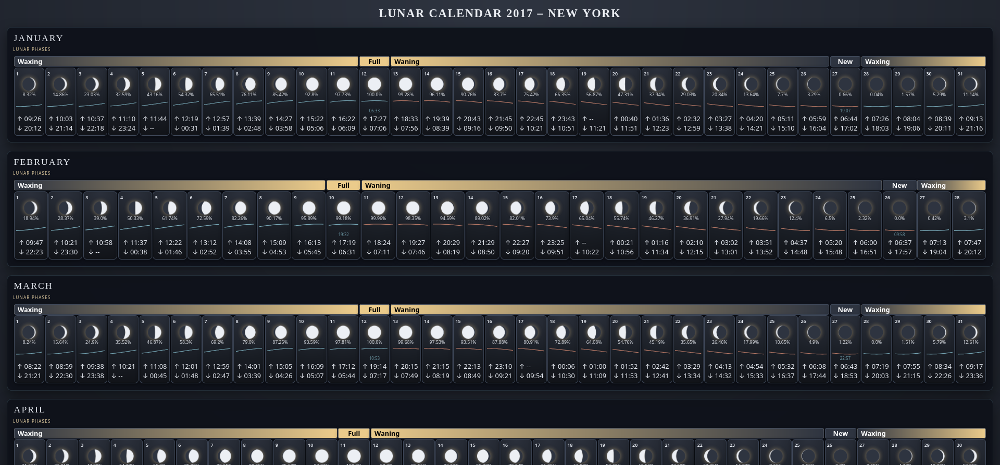
</a>

**Print format**
<a href="screenshots/calendar_2017-print.png">
  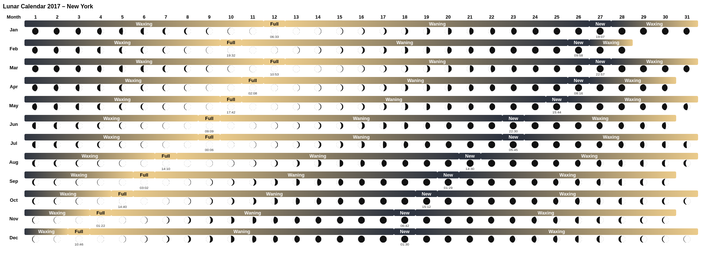
</a>

---

## 🌟 Why this exists

Most moon calendars online are:

- inaccurate
- cluttered with ads
- not printable
- not customizable
- or require an internet connection

NoctiCycle fixes that:

- Everything is computed locally using **Skyfield** and NASA ephemeris data
- Output is a single, portable HTML file
- You choose the year, location, and display options
- The interactive mode produces a modern, elegant layout with a detail card for every day
- The print mode fits the whole year on one landscape page

It’s perfect for planners, journals, almanacs, or anyone who loves tracking the Moon.

---

# 🚀 Features

### ✔ Accurate lunar phase calculations

Uses Skyfield + DE421 ephemeris for precise astronomical results.

### ✔ Localized event times

New/full moon timestamps are converted to your chosen timezone.

### ✔ SVG moon rendering

Each day shows a crisp, resolution‑independent moon icon.

### ✔ Illumination percentage

The Moon’s brightness (0–100%) for each day, on by default (`--hide-luminance` to remove it).
On new/full moon days it is evaluated at the exact event moment unless you pass `--midnight-illumination`.

### ✔ Moonrise and moonset times

`--show-rise-set-times` adds the local rise and set time of the Moon to each day.

### ✔ Event times

The exact local moment of each new/full moon (and quarter, with `--show-quarters`) is shown on its day.
Use `--hide-event-time` to turn it off.

### ✔ Optional illumination trend sparkline

A ±3‑day mini‑graph showing illumination change.  
Enabled via:

```
--illumination-trend
```

### ✔ Two display modes

- **Interactive mode** (default): modern, elegant, visually rich, with a detail card per day and the
  optional layers (`--tradition`, `--moon-names`, `--wheel`)
- **Print mode** (`--print-format`): the whole year on one landscape sheet, legible in black and white
  (see [Print on one landscape page](#print-on-one-landscape-page)). Paper size, moon style and layout are
  set with `--paper`, `--print-style` and `--print-layout`. The layers are not available in print mode and are
  ignored, with a note.

### ✔ Interactive day details

Click (or press Enter on) any day to open a card with a large moon, the phase name,
illumination, moon age, rise/set times (with `--show-rise-set-times`) and the next
new/full moon. When a layer is active, the card also explains the day's lunar tradition entry,
moon name and year-wheel festival, each in its own section. Use the arrow keys to move between
days and Esc to close.

### ✔ Today highlight and next-events banner

The current day is highlighted and scrolled into view, and a banner at the top shows
the next new and full moon with a countdown.

### ✔ Responsive layout and light/dark theme

On narrow screens each month becomes a week grid. The page has a dark theme (the default look, shown
in most screenshots here) and a light theme, and it follows your system's light/dark preference
automatically; there is no manual switch.

<a href="screenshots/theme_light.png">
  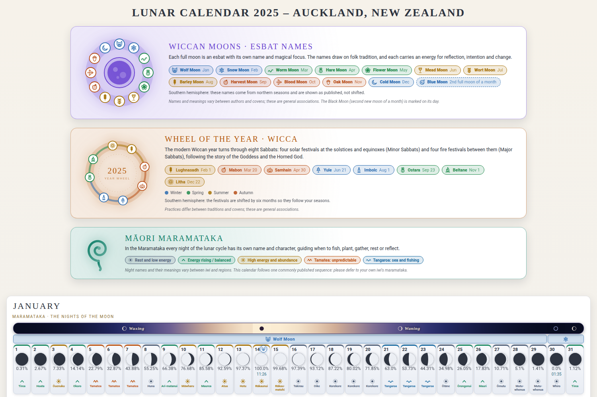
</a>

### ✔ Automatic timezone detection

`--tz` is optional: the timezone is detected from the city's coordinates.

### ✔ Calendar export (.ics)

`--ics [PATH]` exports new, quarter and full moon events for import into Google/Apple/Outlook calendars.
The file is written next to the HTML (or at `PATH`, which must end in `.ics`). With `--moon-names` the
full-moon events carry the moon's name, and with `--wheel` the festivals are added as all-day events.

### ✔ Hemisphere-aware icons and quarter markers

Moon icons are mirrored for locations in the southern hemisphere, and `--show-quarters`
marks first- and last-quarter days.

### ✔ Cultural lunar calendars (`--tradition`)

The Moon has been used as a calendar for thousands of years, and many living cultures give each
day of the lunar month its own name, character and customs. With `--tradition` NoctiCycle lays
one of three such calendars on top of the astronomical one. Each overlay adds a themed banner
and legend, a colour-coded icon and short label on every day, and a full explanation in the
day card (click any day). It works on phones and in light and dark themes.

```
--tradition maori | hindu | wiccan
```

Without the option nothing changes. The overlay is for the interactive page only: with
`--print-format` the option is ignored and a note is printed.

#### `maori`: Māori Maramataka (Aotearoa New Zealand)

The *Maramataka* is the traditional Māori lunar calendar. Every night of the lunar month has a
name (about 29 in total) and a character that guided when to plant, gather, fish or rest. The
cycle starts at the dark moon with **Whiro**, passes through the **Tamatea** nights (changeable,
unpredictable weather and moods), peaks at **Rākaunui** around the full moon, and runs through
the **Korekore** nights (traditionally poor for planting) and the **Tangaroa** nights (good for
fishing) down to **Mutuwhenua**, the nights when the moon "sleeps" before the new one.

NoctiCycle shows the night name for each calendar day (counted at dusk, 18:00 local time, since
the Māori day begins with the night), coloured by character: rest, rising energy, high energy,
Tamatea (unpredictable) and Tangaroa (sea and fishing). The day card gives the meaning.
Southern-hemisphere places such as Auckland also get correctly mirrored moon icons.

<a href="screenshots/tradition_maori.png">
  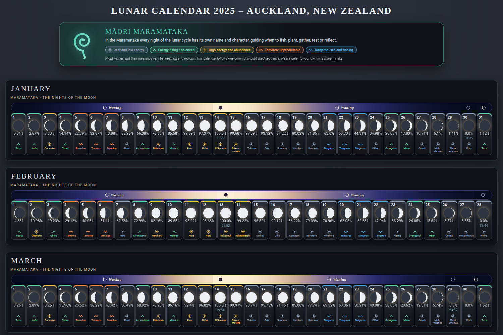
</a>

#### `hindu`: Hindu Panchang, the tithi

The Hindu calendar (*Panchang*) divides the lunar month into 30 **tithis**. A tithi is the time it
takes the Moon to gain 12° of angle on the Sun, so it is purely astronomical. The month has two
halves, or *Pakshas*: **Shukla Paksha** (the waxing, "bright" fortnight, tithis 1–15, ending in
**Purnima**, the full moon) and **Krishna Paksha** (the waning, "dark" fortnight, ending in
**Amavasya**, the new moon). Many observances hang on specific tithis.

NoctiCycle shows the tithi in effect at **local sunrise** for each day, the usual convention for
assigning a tithi to a date. Shukla days are gold and Krishna days indigo. Badges mark
**Ekadashi** (11th tithi, a fasting day), **Purnima**, **Amavasya** (honouring ancestors),
**Chaturthi** (associated with Ganesha), **Pradosha** (13th tithi, associated with Shiva) and
**Maha Shivaratri's** monthly form on Krishna Chaturdashi.

<a href="screenshots/tradition_hindu.png">
  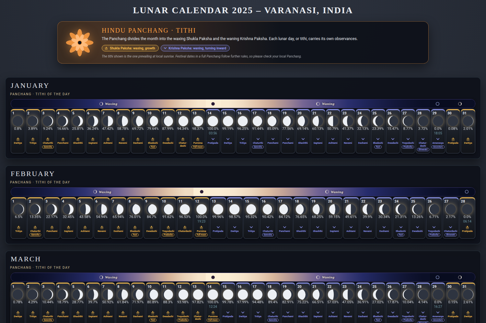
</a>

#### `wiccan`: Wiccan esbats

In Wicca and related modern pagan paths, an **esbat** is a ritual or gathering held at a lunar
phase, most often the full moon (the eight seasonal *sabbats* follow the sun and are not part
of this feature). Practices differ between traditions and covens, but the broad associations are
widely shared: the waxing moon is for beginnings and growth, the full moon for peak power and
celebration, the waning moon for banishing and release, and the dark moon for rest and
reflection.

NoctiCycle labels each day as **dark moon**, **waxing crescent** (initiation), **building**
(first quarter to waxing gibbous), **full moon esbat** (peak) or **waning** (release), each with
its own colour, and adds the esbat badge on full-moon days.

<a href="screenshots/tradition_wiccan.png">
  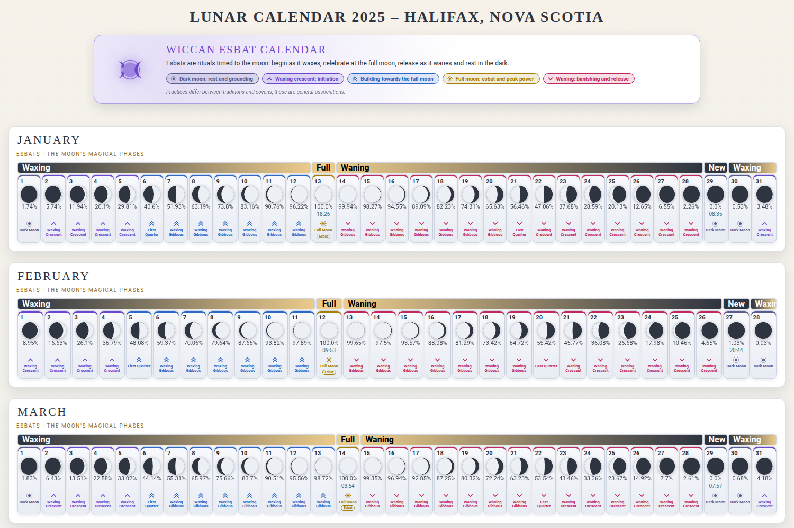
</a>

#### Accuracy and your own version

These are living traditions, and they differ between communities. The names and short meanings
are general summaries written for this project, not authoritative statements of any tradition.
In particular, **Maramataka night names and meanings vary between iwi and regions**, and published
lists disagree in the middle of the cycle, so NoctiCycle uses one commonly published sequence.
The Hindu tithi is the one at sunrise only; festival dates in a full Panchang follow further
regional rules (and a tithi can start or end at any hour), so check a local Panchang for religious
observance. All data lives in `lunar/traditions.py` and is easy to edit to match your own
lineage.

### ✔ Moon names (`--moon-names`)

Many cultures name the moons of the year: the Wolf Moon, the Sugar Moon, the Strawberry Moon. With
`--moon-names` every **lunation** (new moon to next new moon) gets a name, shown as a coloured ribbon with
an icon above its days and as an icon badge on the day of its full moon. A banner shows the whole set as a
ring of icons, one chip under each month lists its named full moon, and the day card tells you **what the
name means** and **what that moon is about**, with a bar showing where the day falls in the lunation.

```
--moon-names anishinaabe | wiccan | almanac | celtic | chinese
```

<a href="screenshots/moons_anishinaabe.png">
  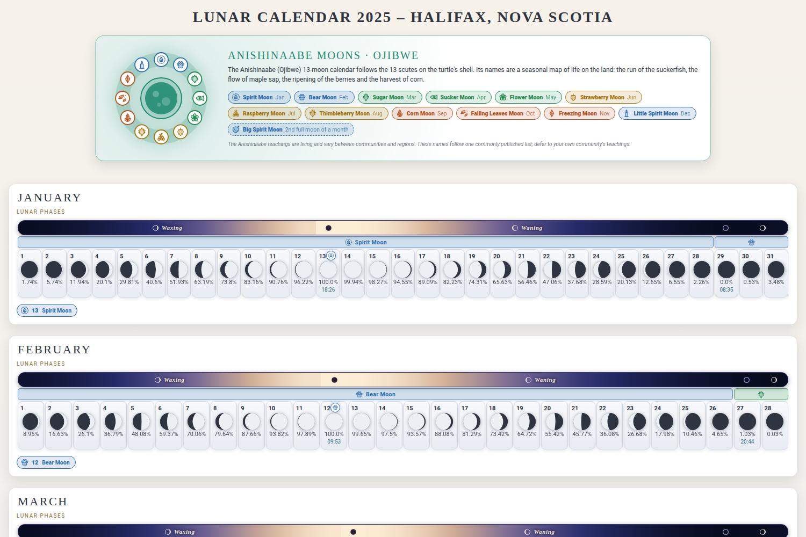
</a>

| `--moon-names` | System | Names |
|---|---|---|
| `anishinaabe` | **Anishinaabe (Ojibwe) 13 moons.** Guided by the 13 scutes of the turtle's shell; the names are a seasonal map of life on the land: the run of the suckerfish, the maple sap, the berries, the corn. | Manidoo Giizis (Spirit Moon), Mkwa Giizis (Bear), Ziisbaakdoke (Sugar), Namebine (Sucker), Waawaaskone (Flower), Ode'miin (Strawberry), Mskomini (Raspberry), Datkaagmin (Thimbleberry), Mdaamiin (Corn), Biinaakwe (Falling Leaves), Mshkawji (Freezing), Manidoo Giizoonhs (Little Spirit), Big Spirit Moon |
| `wiccan` | **Wiccan / Pagan esbat moons.** A ritual calendar: each name carries an energy for intention and change. | Wolf/Storm, Snow/Ice, Worm/Seed, Hare/Egg, Flower/Dyad, Mead, Wort/Hay, Barley/Corn, Harvest, Blood/Hunter's, Oak/Frosty, Cold/Long Night, Blue/Black |
| `almanac` | **Almanac / Algonquin ("colonial hybrid").** The best-known names outside religious practice, popularised by agricultural almanacs. | Wolf, Snow, Worm, Pink, Flower, Strawberry, Buck, Sturgeon, Corn/Harvest, Hunter's, Beaver, Cold, Blue |
| `celtic` | **Celtic Tree Calendar.** Thirteen 28-day tree months from 24 December, named for the Ogham trees. A lunation takes the tree month of its full moon. | Birch, Rowan, Ash, Alder, Willow, Hawthorn, Oak, Holly, Hazel, Vine, Ivy, Reed, Elder |
| `chinese` | **Chinese lunar months.** A true lunar calendar: months start at the new moon, the New Year is the second new moon after the winter solstice, and a leap month is added about every three years. | Months 1 to 12 (each with its flower and season), leap months, and the lunar date of every day, with the eight best-known festivals (Spring, Lantern, Dragon Boat, Qixi, Ghost, Mid-Autumn, Double Ninth, Laba) |

<a href="screenshots/moons_chinese.png">
  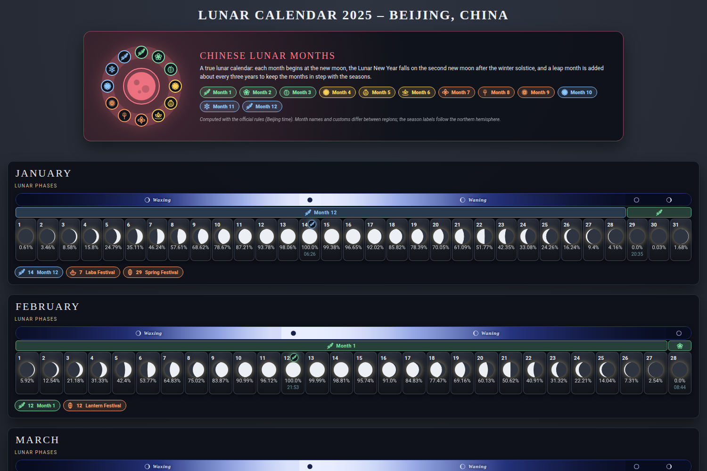
</a>

**The naming rule.** For the first three systems (and the tree calendar) a lunation takes the name of the
calendar month in which its **full moon** falls. When a month has **two full moons**, the second is the 13th,
leap moon: the **Blue Moon** (the *Big Spirit Moon* in the Anishinaabe set). The Wiccan set also marks a
**Black Moon**, the second new moon of a month, on its day. The Chinese months follow the official rules,
computed from the sky in Beijing time (so Lunar New Year falls on 29 January 2025 and 17 February 2026, and 2025
has a leap sixth month).

<a href="screenshots/moons_blue_moon_card.png">
  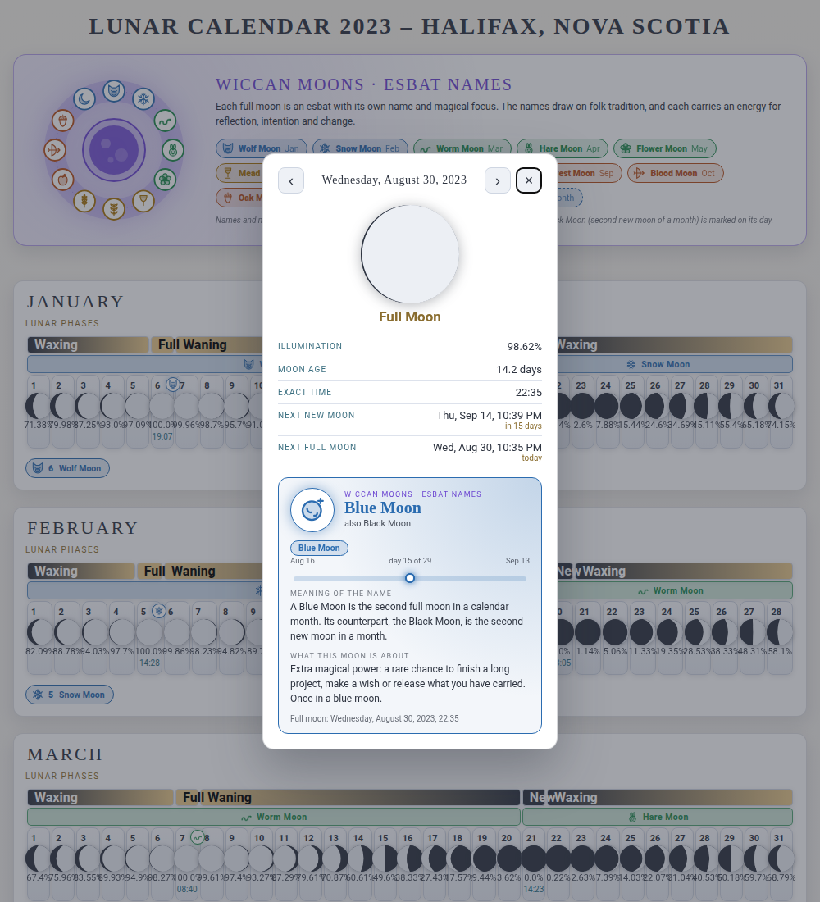
</a>

**Layers combine.** `--moon-names`, `--wheel` and `--tradition` are independent: you can show named moons,
a year wheel and a lunar tradition at the same time, and the day card shows a section for each.

<a href="screenshots/moons_three_layers.png">
  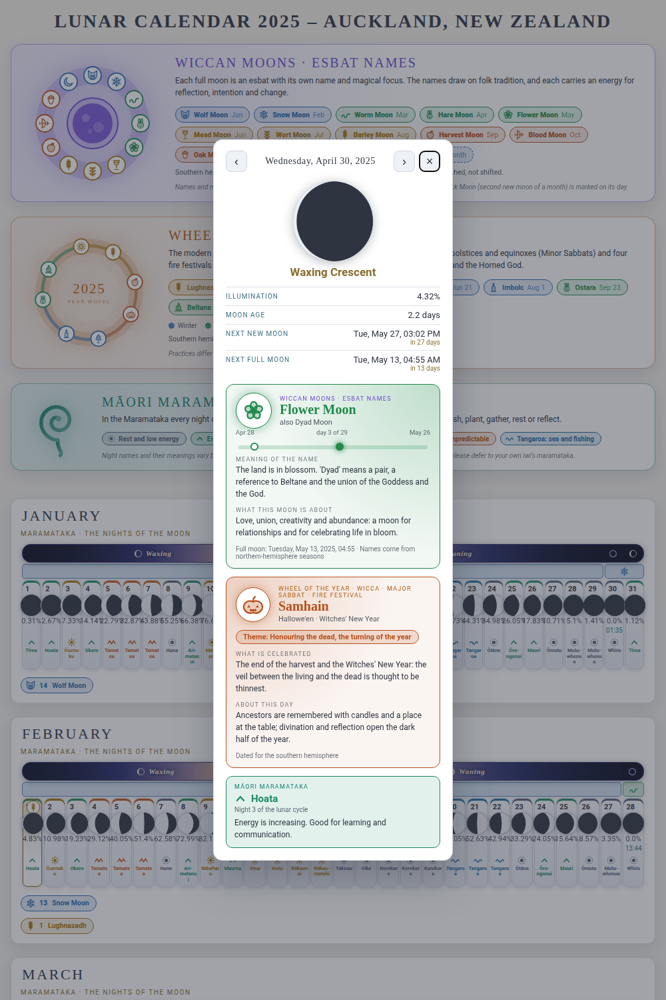
</a>

**Accuracy and respect.** These are living traditions and the names differ between communities, authors and
regions. The Anishinaabe, Wiccan and Almanac names follow a published table; the meanings are short general
summaries written for this project, not authoritative teachings, and the Anishinaabe teachings in particular
should be learned from your own community. The Celtic Tree Calendar was assembled by the poet Robert Graves in
1948 and has no ancient Celtic origin. The names come from northern-hemisphere seasons, so for the southern
hemisphere they are shown as published, with a note, and not shifted. The Chinese names and festivals appear in
Chinese characters on the day card, which need a CJK font (installed by default on most systems). All the data is
in `lunar/moon_names.py` and easy to edit. `--moon-names` is only available in the interactive layout and is ignored,
with a note, when you use `--print-format`. With `--ics` the full-moon events carry the moon's name.

### ✔ Year wheels (`--wheel`)

Where `--tradition` follows the *Moon* through the month, a **year wheel** follows the *Sun* through the
year: the festivals that a tradition keeps at the solstices, equinoxes and in between. Each festival
appears on its day with its own icon, in a colour that shows its season, on a wheel graphic in the
banner and as a chip under its month. Click the day (or the chip) and the day card explains the
festival: its **name**, its **theme**, **what is celebrated** and what happens on the day.

```
--wheel wicca | druid | slavic | eastasian | heathen
```

A wheel can be **combined with a tradition**: for example `--wheel wicca --tradition wiccan` shows the
Wheel of the Year together with the Wiccan esbats, and the day card shows both.

<a href="screenshots/wheel_wicca_esbat.png">
  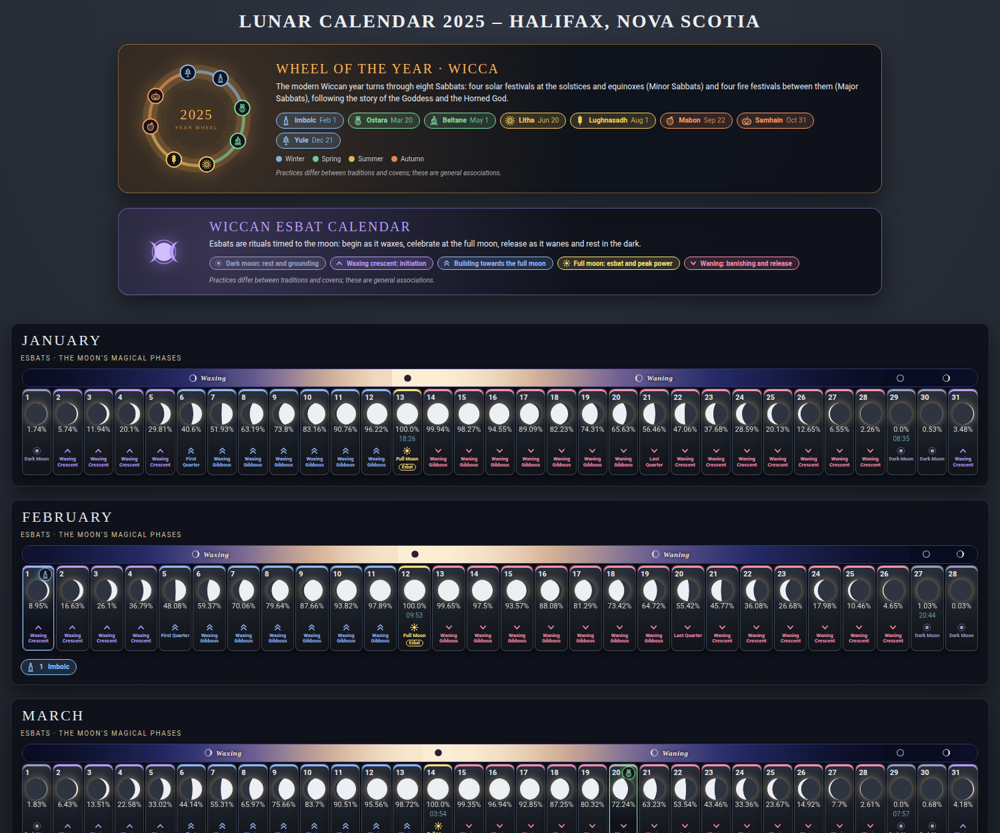
</a>

| `--wheel` | Tradition | Festivals |
|---|---|---|
| `wicca` | **Wicca: the Wheel of the Year.** Eight Sabbats following the Goddess and the Horned God: four solar *Minor Sabbats* and four *Major Sabbats* (fire festivals). | Yule, Imbolc, Ostara, Beltane, Litha, Lughnasadh, Mabon, Samhain |
| `druid` | **Modern Druidry: the Eightfold Wheel.** Close to the Wiccan wheel in structure, but centred on *Awen* (divine inspiration) and the local landscape. | Alban Arthuan, Imbolc, Alban Eilir, Beltane, Alban Heruin, Lughnasadh, Alban Elued, Samhain |
| `slavic` | **Rodnovery: Kolo Goda.** The living Slavic native faith, anchored in Slavic folklore and gods such as Perun and Veles, and in ancestor remembrance. | Koliada, Gromnica, Jare Gody, Radonitsa, Kupala Night, Perun's Day, Plodovi, Dziady |
| `eastasian` | **East Asian calendars: the 24 solar terms** (*jiéqì*), used in China, Korea, Vietnam and Japan for farming, health and festivals. The eight cornerstones (solstices, equinoxes and the four "starts" of the seasons) are shown as icons and the other sixteen as small markers. | Lìchūn, Chūnfēn, Lìxià, Xiàzhì, Lìqiū, Qiūfēn, Lìdōng, Dōngzhì, plus 16 more |
| `heathen` | **Heathenry / Ásatrú: seasonal tides.** A living calendar of communal *blóts*. Many Heathens avoid Wiccan terms, so the names here are the Norse and Germanic ones. | Yule, Dísablót, Ostara/Sigrblót, Midsummer, Winter Finding, Winternights |

<a href="screenshots/wheel_day_card.png">
  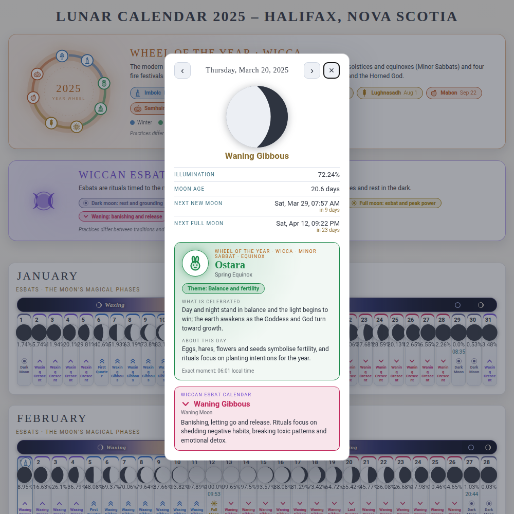
</a>

**How the dates are found.** Solstices, equinoxes and the 24 solar terms are computed from the Sun's
position (its ecliptic longitude), to the minute, in your timezone, so they are right for any year. The
day card shows the exact moment. The cross-quarter festivals (Imbolc, Beltane, Lughnasadh, Samhain and
similar) have fixed dates; they traditionally begin at sunset on the evening before.

**Southern hemisphere.** The Wicca, Druid and Heathen wheels describe the northern seasons, so for a
location south of the equator they are shifted by six months, the common practice: Yule falls at the
June solstice and Samhain at the end of April, for example. The Slavic and East Asian wheels are tied to
the northern hemisphere's seasons and are never shifted.

<a href="screenshots/wheel_eastasian.png">
  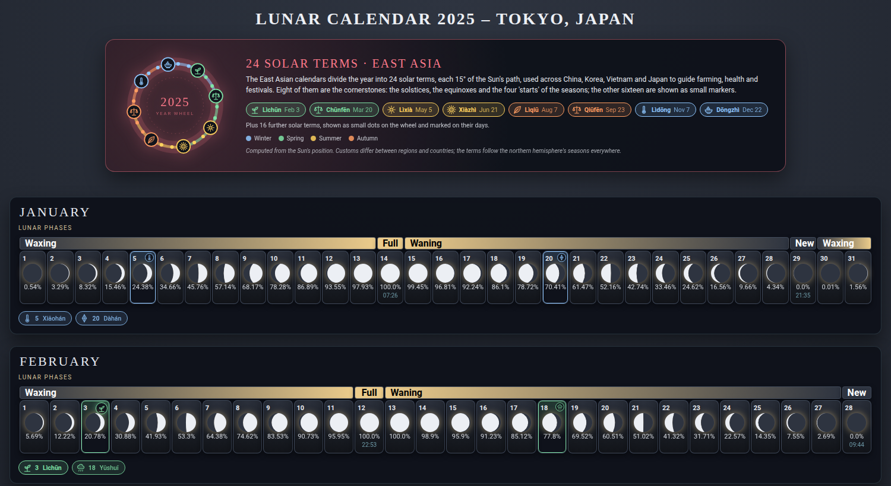
</a>

**Accuracy.** These are living traditions and groups differ in names, dates and customs. The texts are
short, general summaries written for this project, and several fixed dates are approximate (Radonitsa,
Perun's Day, Dziady, Dísablót and Winternights vary between communities; the day card says so). All
the data is in `lunar/wheels.py` and easy to edit. `--wheel` is only available in the interactive layout
and is ignored, with a note, when you use `--print-format`. With `--ics` the festivals are also exported
as all-day events.

### ✔ Fully offline

Once generated, the HTML file requires no internet connection. Generating it needs the internet only
once, to download the ephemeris (about 17 MB, cached as `de421.bsp`) and, unless you pass `--tz`, to look the
city up.

---

# 📦 Installation

NoctiCycle requires a few external Python packages:

- **Skyfield** — astronomical calculations
- **tzdata** — timezone definitions for systems without IANA zoneinfo
- **geopy** — obtain latitudes and longitudes via OpenStreetMap (Nominatim)
- **timezonefinder** — detect the timezone from the coordinates (only needed when `--tz` is omitted)

Install them with:

```bash
pip install skyfield tzdata geopy timezonefinder
```

---

## 🔧 Why these packages?

### **skyfield**

Used for:

- Loading NASA’s DE421 ephemeris
- Computing lunar positions
- Determining new/full moon events
- Calculating illumination and phase angles

### **tzdata**

Provides timezone definitions for platforms that **don’t ship with IANA zoneinfo**, such as:

- Windows
- Minimal Linux containers
- Some embedded environments

If your system already has full zoneinfo support, `tzdata` simply ensures portability.

---

# 🐍 Using a Python Virtual Environment (Recommended)

A virtual environment keeps dependencies isolated and avoids polluting your system Python.

### 1. Create a virtual environment

```bash
python3 -m venv .venv
```

### 2. Activate it

**macOS / Linux:**

```bash
source .venv/bin/activate
```

**Windows (PowerShell):**

```powershell
.venv\Scripts\Activate.ps1
```

### 3. Install dependencies inside the venv

```bash
pip install skyfield tzdata geopy timezonefinder
```

### 4. Run the script

```bash
python3 nocticycle.py --city "Halifax" --tz "America/Halifax" --year 2025
```

### 5. Deactivate when done

```bash
deactivate
```

---

# 📦 How It Works

## 1. You choose a year **and** location

Only `--city` is required (`--tz` is detected automatically and `--year` defaults to the current year):

```
python3 nocticycle.py --city "Halifax" --tz "America/Halifax" --year 2025
```

## 2. NoctiCycle computes all lunar events

- New moons
- Full moons
- Quarter moons (optional)
- Daily illumination and moon age
- Phase classification and, optionally, rise/set times and trend data
- Optionally the layers: lunar-day meanings, moon names, solstices/equinoxes/solar terms and festival dates

## 3. It renders a complete HTML calendar

- One year, twelve months
- SVG moons and phase bands
- Optional sparklines, quarters and the three cultural layers
- Or a one-page print layout

## 4. You open the file in any browser

`lunar_calendar_<city>_2025.html` (or the path given with `-o`)

---

# 🧩 Project layout

`nocticycle.py` is a thin launcher; the code lives in the `lunar/` package:

| Module | Role |
|---|---|
| `config.py` | Defaults and shared runtime state |
| `cli.py` | Command-line parsing, output-path validation |
| `location.py` | Geocoding, timezone detection, observer |
| `sky.py` / `astro.py` | Skyfield setup; phases, illumination, moon age, tithi |
| `moon_svg.py` | SVG moons and sparklines |
| `traditions.py` / `tradition_days.py` | Cultural calendar data and per-day lookup |
| `wheels.py` / `wheel_icons.py` / `solar.py` | Year-wheel festivals and icons; solar terms computed from the Sun |
| `moon_names.py` / `lunations.py` / `icons_moon.py` | Named moons; lunations, Blue/Black Moons and the Chinese calendar; moon icons |
| `html_writer.py` / `print_writer.py` | Interactive and print outputs |
| `ics.py` | Calendar export |
| `assets.py` / `dates.py` | CSS/JS loading, date helpers |
| `app.py` | `main()` wiring everything together |

CSS and JS stay in `css/` and `js/`.

---

# ⚙️ Configuration

Defaults live in `lunar/config.py`:

```python
YEAR = 2026                    # CLI default: the current year
SHOW_LUMINANCE = True
SHOW_EVENT_TIME = True
USE_EXACT_EVENT_ILLUMINATION = True
COSMETICS_MODE = True          # False with --print-format
ILLUMINATION_TREND = False
```

(The layer, quarter and print settings are set from the command line only: `--tradition`, `--wheel`,
`--moon-names`, `--show-quarters`, `--paper`, `--print-style` and `--print-layout`.)

Command-line flags override these values.

### Required CLI parameters

```
--city "Your City"
```

### Optional parameters

```
--tz "Your/Timezone"       timezone (default: detected from the city)
--year 2027                year (default: current year)
-o, --output FILE.html     output path (default: lunar_calendar_<city>_<year>.html)
-h, --help                 show all options

--show-luminance / --hide-luminance        illumination % per day (default: shown)
--show-event-time / --hide-event-time      times of new/full moons (default: shown)
--exact-event-illumination                 illumination at the event moment (default)
--midnight-illumination                    illumination at local midnight instead
--illumination-trend                       ±3-day sparkline per day
--show-rise-set-times                      moonrise and moonset
--show-quarters                            mark first/last quarter days
--ics [PATH]                               export events as an .ics file

--tradition maori|hindu|wiccan             lunar tradition: a meaning for every day
--moon-names anishinaabe|wiccan|almanac|celtic|chinese   a name for every moon (lunation)
--wheel wicca|druid|slavic|eastasian|heathen             yearly festivals (year wheel)

--print-format                             one-page print layout
--paper letter|a4|legal|tabloid            print paper size (default: letter)
--print-style grey|hatched|solid           print moon style (default: grey)
--print-layout rows|columns                print layout (default: rows)
```

How the switches relate:

- `--tradition`, `--moon-names` and `--wheel` are independent and can all be used together.
- Those three, `--illumination-trend` and the rise/set times only exist in the interactive layout. With
  `--print-format` the three layers are ignored with a note; `--paper`, `--print-style` and `--print-layout`
  only apply to `--print-format`.
- `--show-*`/`--hide-*` pairs: the last one given wins. `--exact-event-illumination` and `--midnight-illumination`
  are alternatives.
- Rise/set times, hemisphere-aware icons and the wheel dates need the city's coordinates, so they need the
  internet (or a successful earlier lookup); `--tz` alone only replaces the timezone detection.

Run `python3 nocticycle.py --help` for the full list.

---

# 🏃 Usage

### Basic run (required flags)

```
python3 nocticycle.py --city "Halifax" --tz "America/Halifax"
```

### Specify year

```
python3 nocticycle.py --city "Halifax" --tz "America/Halifax" --year 2027
```

### Print‑friendly layout

```
python3 nocticycle.py --city "Halifax" --tz "America/Halifax" --print-format
```

### Print on one landscape page

```
python3 nocticycle.py --city "Halifax" --year 2026 --print-format --paper a4
```

The whole year is fitted on a single landscape sheet (`letter`, `a4`, `legal` or `tabloid`).
Print format shows the weekday, day number, moon and illumination for every day, weekends
shaded, new/full moon days highlighted (quarters with `--show-quarters`), and a footer listing
the exact event times. Rise/set times and trend graphs are not part of the print format.

- `--print-style grey|hatched|solid` chooses how the dark side of the moon is drawn
  (`hatched` is best on black-and-white printers).
- `--print-layout columns` puts months across and days down the page, planner style.
  Moon icons are smaller there than in the default `rows` layout.
- In your browser's print dialog, set margins to "Default" or "None", scale to 100% and turn
  on "Background graphics" for the best result.

### Enable illumination trend sparkline

```
python3 nocticycle.py --city "Halifax" --tz "America/Halifax" --illumination-trend
```

### Export the events to a calendar app

```
python3 nocticycle.py --city "Halifax" --year 2026 --ics
```

Writes an `.ics` file next to the HTML (or at `--ics PATH`) with the new, quarter and full moon
events, ready to import into Google, Apple or Outlook calendars.

### Cultural calendars

See [Cultural lunar calendars](#-cultural-lunar-calendars---tradition) for what each one shows.

```
python3 nocticycle.py --city "Auckland" --tradition maori
python3 nocticycle.py --city "Varanasi" --tradition hindu --show-rise-set-times
python3 nocticycle.py --city "Halifax" --tradition wiccan
```

### Moon names

See [Moon names](#-moon-names---moon-names) for what each one shows.

```
python3 nocticycle.py --city "Halifax" --moon-names almanac
python3 nocticycle.py --city "Thunder Bay" --moon-names anishinaabe --ics
python3 nocticycle.py --city "Beijing" --moon-names chinese --wheel eastasian
python3 nocticycle.py --city "Auckland" --moon-names wiccan --wheel wicca --tradition maori   # three layers
```

### Year wheels

See [Year wheels](#-year-wheels---wheel) for what each one shows.

```
python3 nocticycle.py --city "Halifax" --wheel wicca
python3 nocticycle.py --city "Tokyo" --wheel eastasian
python3 nocticycle.py --city "Halifax" --wheel wicca --tradition wiccan   # wheel + esbats
python3 nocticycle.py --city "Auckland" --wheel druid --tradition maori --ics
```

### Mark quarter moons

```
python3 nocticycle.py --city "Halifax" --year 2026 --show-quarters
```

### Combine flags

```
python3 nocticycle.py --city "Halifax" --tz "America/Halifax" --year 2026 --illumination-trend --show-event-time
```

### Combine the layers

```
# Wheel of the Year, esbat moon names and esbat phases together, with a calendar export
python3 nocticycle.py --city "Halifax" --wheel wicca --moon-names wiccan --tradition wiccan --ics
```

---

# 🌓 Display Options

### Illumination percentage

Shows the Moon’s brightness (0–100%).

### Event times

Shows the exact local time of new/full moon.

### Illumination trend sparkline

A ±3‑day mini‑graph showing illumination change.  
Great for quickly seeing waxing vs waning.

### Layers

- `--tradition`: a coloured icon and short label on every day (night name, tithi or phase) and a full entry in the day card.
- `--moon-names`: a ribbon over each lunation, an icon badge on the full-moon day and a chip under the month.
- `--wheel`: a glowing icon badge on each festival day, a chip under the month and a banner with the year wheel.

### Interactive vs Print mode

- Interactive mode includes colours, day cards, sparklines, rise/set times and the three cultural layers.
- Print mode strips it down to what reads well on paper: weekday, day, moon, illumination and an event list.

---

# 🛡 Error Handling

NoctiCycle:

- Looks up the city and lets you pick when the name is ambiguous
- Validates the timezone and output path
- Falls back gracefully when geocoding is unavailable and `--tz` is given
- Fails with clear messages instead of tracebacks

---

# 📄 Output

The script generates:

```
lunar_calendar_<city>_<YEAR>.html
```

in the project folder, unless you choose another path with `-o`. With `--ics` an `.ics` file with the same
name (or the path you give) is written as well.

Open it in any browser.  
Share it. Print it. Use it in journals or planners.

---

# 🧪 Example Workflow

1. You run:
    
    ```
    python3 nocticycle.py --city "Halifax" --tz "America/Halifax" --year 2025 --illumination-trend
    ```
    
2. NoctiCycle computes all lunar data for 2025.
    
3. It generates `lunar_calendar_Halifax_2025.html`.
    
4. You open it and see:
    
    - Moon icons
    - Illumination
    - Phase bands
    - New/full moon times
    - Trend sparklines
5. You print it or embed it in your digital planner.

Add `--wheel`, `--moon-names` and `--tradition` to the command to see festivals, moon names and lunar-day
meanings on the same calendar.

---

# ❓ FAQ

## Why can I still pass --tz if it is detected automatically?

Because a city name alone is not enough to determine the correct local time.
Geocoding gives us latitude and longitude for astronomical calculations, but it does not provide timezone information. Timezones follow political boundaries, not geography, and cities with the same name can exist in different timezones.

NoctiCycle needs the exact IANA timezone (including DST rules) to convert UTC lunar events into accurate local times.
NoctiCycle looks the timezone up from the geocoded coordinates, so `--tz` is optional. Passing it explicitly overrides the detection (useful offline or for unusual cases) and ensures that rise/set times, phase events, and illumination values are computed correctly for your location.

## Which options can I combine?

All of them in the interactive layout, including the three layers (`--tradition`, `--moon-names`, `--wheel`).
`--print-format` is a separate layout: it ignores the layers (with a note) and is the only one that uses `--paper`,
`--print-style` and `--print-layout`.

## Do the cultural names and festivals change in the southern hemisphere?

The Wicca, Druid and Heathen wheels are shifted by six months south of the equator; the Slavic and East Asian
wheels, the moon names and the lunar traditions are shown as published, with a note where relevant. The moon icons
are always mirrored to match the view from your hemisphere.

## Why do some days show “--” for moonrise or moonset?

**Short answer**: 
Because on some calendar days, the Moon simply does not cross the horizon.

**Long answer**: 
The Moon rises about 50 minutes later each day, and its orbit is tilted relative to Earth. Because of this, several natural situations occur:

    The Moon may rise late at night and the next rise happens after midnight the following day, so one calendar day contains no rise.

    The Moon can stay above the horizon for more than 24 hours, producing a day with no rise or set.

    The Moon can stay below the horizon for more than 24 hours, producing the same effect.

This is normal lunar motion, especially at mid‑northern latitudes.
When no rise or set occurs between 00:00 and 23:59 local time, the calendar displays `--` or a mix of times and `--`:

```↑ --   ↓ --```

This does not mean the Moon is hidden by daylight — it means it never crossed the horizon during that date.

---

# 📜 License (MIT)

```
MIT License

Copyright (c) 2026 Valerio Fuoglio

Permission is hereby granted, free of charge, to any person obtaining a copy
of this software and associated documentation files (the “Software”), to deal
in the Software without restriction, including without limitation the rights
to use, copy, modify, merge, publish, distribute, sublicense, and/or sell
copies of the Software, and to permit persons to whom the Software is
furnished to do so, subject to the following conditions:

The above copyright notice and this permission notice shall be included in
all copies or substantial portions of the Software.

THE SOFTWARE IS PROVIDED “AS IS”, WITHOUT WARRANTY OF ANY KIND, EXPRESS OR
IMPLIED, INCLUDING BUT NOT LIMITED TO THE WARRANTIES OF MERCHANTABILITY,
FITNESS FOR A PARTICULAR PURPOSE AND NONINFRINGEMENT. IN NO EVENT SHALL THE
AUTHORS OR COPYRIGHT HOLDERS BE LIABLE FOR ANY CLAIM, DAMAGES OR OTHER
LIABILITY, WHETHER IN AN ACTION OF CONTRACT, TORT OR OTHERWISE, ARISING FROM,
OUT OF OR IN CONNECTION WITH THE SOFTWARE OR THE USE OR OTHER DEALINGS IN
THE SOFTWARE.
```
